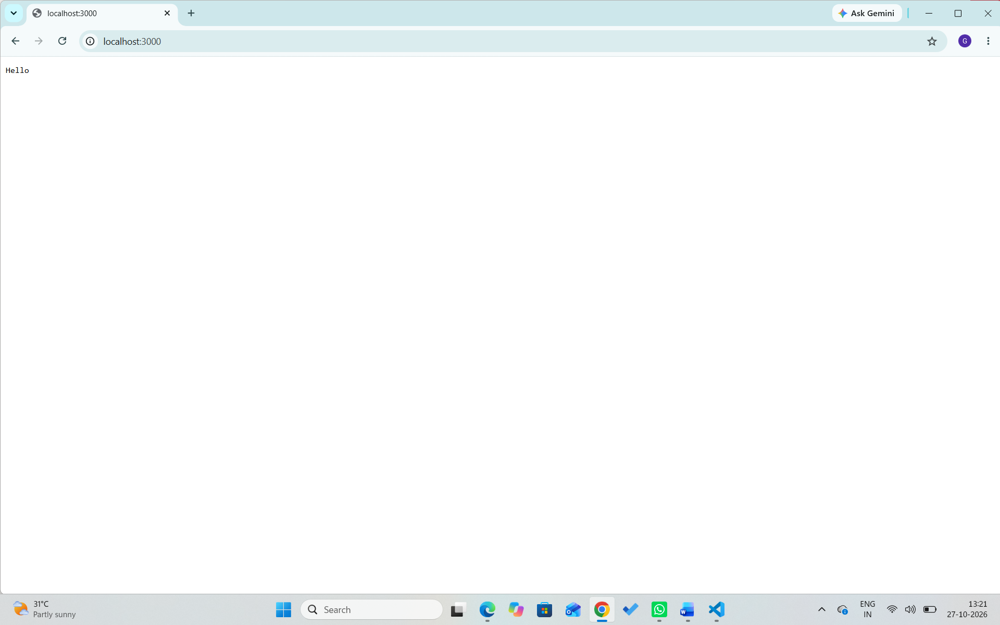
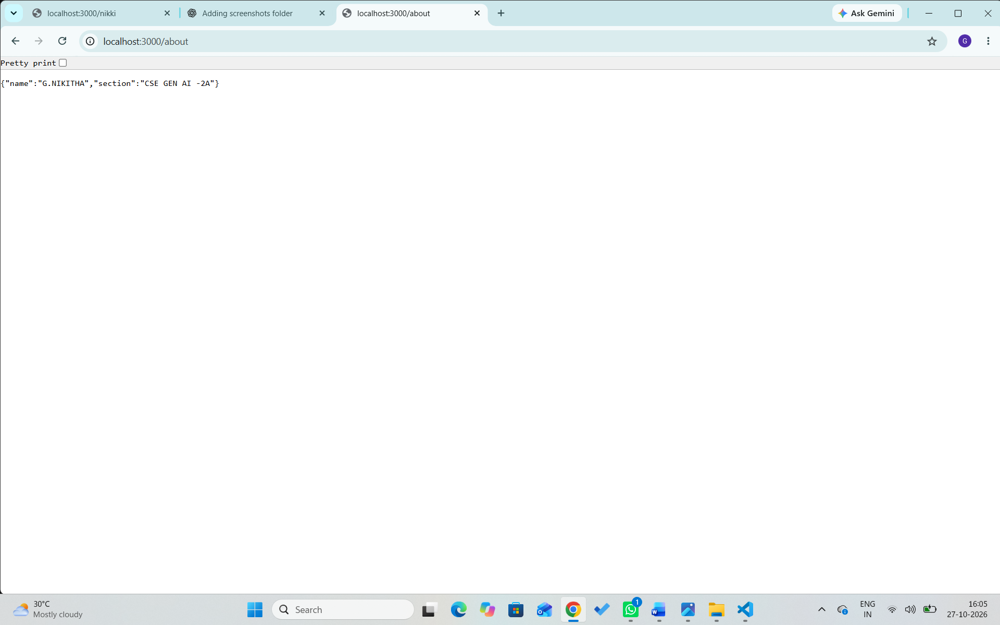
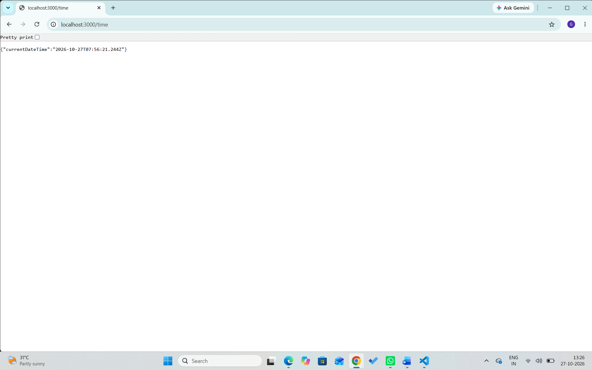

# Lab 1: Node.js and Express server

## Student Details
- Name: G.Nikitha
- Registration Number: 252U1R9035
- Section: CSE GAI-2A
- Course: Backend Development Fundamentals
- Lab Number: 01

## Live Link
https://lab-1-fv68.onrender.com

## Objective
To create a Node.js HTTP server and an Express server with multiple routes.

## Technologies Used

- Node.js
- Express.js
- JavaScript
- npm
- Visual Studio Code

## Project Structure

```text
Lab/
├── Screenshots/
│   ├── about.png
│   ├── hello.png
│   ├── error.png
│   ├── time.png
│   └── welcome.png
├── .gitignore
├── package.json
├── package-lock.json
├── README.md
├── server-http.js
└── server.js
```

## Installation and Setup

### Prerequisites

- Node.js and npm installed
- Visual Studio Code or another code editor

### Steps to Run

1. Clone the repository or download the project.
2. Open the `lab-01` folder in the terminal.
3. Install the dependencies:

   ```bash
   npm install
   ```

4. Start the Express server:

   ```bash
   node server.js
   ```

5. Open the following URL in your browser:

   `http://localhost:3000`

### Run the Basic HTTP Server

To run the server implemented using Node.js's built-in HTTP module:

```bash
node server-http.js
```

Stop the running server with `Ctrl + C` before starting another server on the same port.

## Endpoints

| Method | Endpoint | Description | Expected Status |
|---|---|---|---|
| GET | `/` | Returns a welcome message | 200 OK |
| GET | `/about` | Returns the student's name and section as JSON | 200 OK |
| GET | `/time` | Returns the current date and time | 200 OK |
| GET | `/anything` | Demonstrates the response for an unknown route | 404 Not Found |

The `/anything` path is an example of an unknown route. Other undefined paths should also return a 404 response.

## Screenshots

### Hello Route
Displays the hello message.


### Welcome Route
Displays the welcome message.


### About Route
Displays the student's name and section in JSON format.


### Time Route
Displays the current date and time.


### Error Route
Displays the 404 Page Not Found response.


## HTTP Status Codes
- **200 OK:** The request was successful.
- **404 Not Found:** The requested route does not exist.

## Viva Questions

### 1. What is the difference between `package.json` and `node_modules`?

`package.json` stores project metadata, scripts, and dependency information. `node_modules` contains the installed packages required by the project.

### 2. What does `app.listen()` do?

`app.listen()` starts the Express server and makes it listen for incoming requests on a specified port.

### 3. What do `request` and `response` represent?

`request` contains information about the incoming HTTP request. `response` is used to send data and status codes back to the client.

## Problems Faced and Solutions
The server did not start because the port was already in use, so I stopped the existing server and restarted the application.

## Git and Repository Notes

- The `.gitignore` file excludes `node_modules/` and `.env`.
- The `node_modules/` directory must not be committed.
- Screenshots are stored in the `screenshots/` directory.
- The project is submitted through the course GitHub repository.